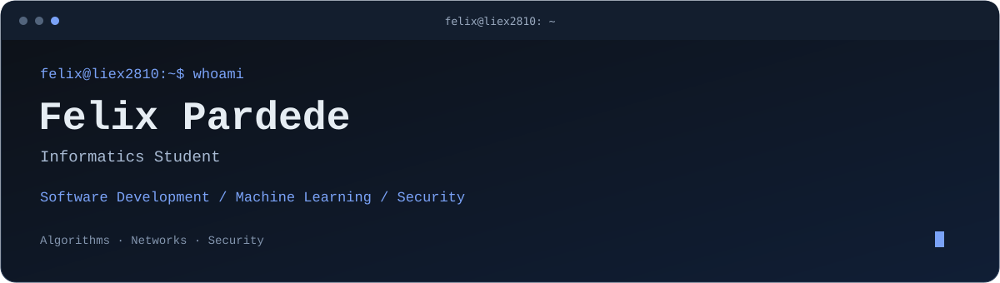

<p align="center">
  
</p>

<p align="center">
  <a href="https://github.com/Liex2810"></a>
</p>

<!-- Add your verified social URLs here, then remove this comment block.
<p align="center">
  <a href="YOUR_LINKEDIN_URL"></a>
  <a href="YOUR_INSTAGRAM_URL"></a>
</p>
-->

## About

```python
profile = {
    "name": "Felix Pardede",
    "call_me": "Felix",
    "username": "Liex2810",
    "role": "Informatics Student",
    "interests": ["Software Development", "Machine Learning", "Security"],
    "focus": ["Algorithms", "Networks", "Security"],
}
```

I'm Felix, an informatics student who enjoys understanding how systems work, solving problems, and building useful software. My interests span software development, machine learning, and cybersecurity, with a particular focus on algorithms, networks, and security.

This space brings together my projects, coding exercises, and learning notes as I turn concepts into practice.

## 🛠️ Stack

### Programming Languages


### Web Development


### Data Science & Machine Learning


### Databases


### Development & Design


## Currently Learning


## Projects & Learning Archive

| Collection | Status |
| :--- | :--- |
| **BCA-FutureTry** | Private project |
| **Semester 1** | Coding exercises and learning notes — coming soon |
| **Semester 2** | Coding exercises and learning notes — coming soon |
| **Semester 3** | Coding exercises and learning notes — coming soon |

<!-- Add public repository links to the collections above when they are available. -->

---

<p align="center"><samp>Liex2810 · Felix Pardede</samp></p>
